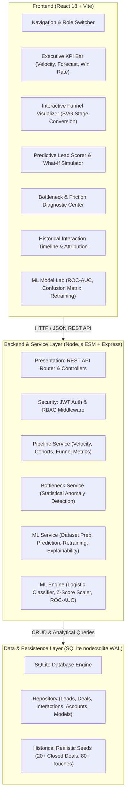

# AI-Powered Sales Funnel Analyzer

> An enterprise-grade B2B sales pipeline intelligence and machine learning command center. Visualizes end-to-end funnel conversion stages, diagnoses pipeline friction and bottlenecks with empirical statistical models, and predicts deal win probabilities with local explainability (SHAP-style additive feature attribution) from historical interaction touchpoints.

---

## 🌟 Key Features

1. **Interactive Funnel Visualizer**:
   - Dynamic stage visualization tracking transition conversion rates, cycle duration (days in stage), drop-off percentages, and active deal volume.
   - Stage-level health indicators (`HEALTHY`, `WARNING`, `BOTTLENECK`) benchmarked against industry target distributions.
   - Clickable drill-down into specific deals currently active in any stage.

2. **In-House Machine Learning Conversion Engine**:
   - Supervised classification using **Logistic Regression with L2 Weight Regularization** and gradient descent optimization with momentum.
   - 10-dimensional feature engineering from historical interaction touches (recency, frequency, economic buyer presence, executive alignment, deal scale, and stage velocity).
   - Z-Score feature normalization (`StandardScaler`) with deterministic state serialization.
   - Comprehensive model evaluation: Accuracy, Precision, Recall, F1-Score, Cross-Entropy Log-Loss, 2x2 Confusion Matrix, and ROC-AUC via trapezoidal numerical integration.

3. **Predictive Lead Scoring & Local Explainability**:
   - Real-time conversion probability scores ($P(\text{Win}) \in [0.0, 1.0]$) categorized into `HIGH_CONVERSION` ($\ge 70\%$), `MEDIUM_RISK` ($40\% - 69\%$), and `LOW_CONVERSION` ($< 40\%$).
   - Local feature attribution isolating top positive drivers and top negative risk factors per deal.
   - Automated, prescriptive **Next Best Action** recommendations tailored to each deal's specific feature profile.

4. **Interactive What-If Simulation Sandbox**:
   - Live modal simulation testing the impact of buyer interactions (e.g. adding touchpoints, engaging the Economic Buyer, scheduling an architecture demo, or altering discount percentages).
   - Real-time comparison showing baseline probability vs simulated probability and projected shift ($\Delta P$).

5. **Statistical Bottleneck & Friction Diagnostics**:
   - Detects abnormal drop-offs and cycle time stalls using variance thresholds.
   - Identifies stalled opportunities past healthy duration thresholds and calculates **Total Revenue at Risk**.
   - Prescriptive remediation playbooks per stage.
   - Live benchmark target editor for RevOps Administrators.

6. **Historical Multi-Touch Activity Timeline**:
   - Chronological touchpoint feed covering Emails, Demos, Technical Scoping, Executive Alignment, and Contract Redlines.
   - Buyer sentiment tracking (`POSITIVE`, `NEUTRAL`, `NEGATIVE`) with interactive "+ Log Touchpoint" capability.

7. **Pipeline Velocity & Comparative Revenue Forecasting**:
   - Mathematical Sales Throughput ($/day):
     $$V = \frac{\text{Qualified Opportunities Count} \times \text{Win Rate} \times \text{Avg Deal ACV}}{\text{Sales Cycle Length (Days)}}$$
   - 4-way comparative forecast: AI Predicted Win Revenue vs Traditional CRM Weighted Pipeline vs Commit ($90\%$) vs Best Case.
   - Sales Representative leaderboard ranking reps by velocity, win rate, and closed-won revenue.

8. **Role-Based Access Control (RBAC) & Persona Switcher**:
   - Seamless switcher between personas:
     - **Elena Rostova** (`revops_admin`) — Full system governance, model retraining, benchmark target adjustments.
     - **Sarah Chen** (`sales_manager`) — Team oversight, pipeline forecasting, model retraining.
     - **Alex Miller** (`sales_rep`) — Deal inspection, what-if simulations, touchpoint logging.

---

## 🏛 System Architecture



---

## 🚀 Quickstart & Setup

### Prerequisites
- Node.js $\ge 22.5.0$ (utilizes native `node:sqlite`)
- npm $\ge 10.0.0$

### 1. Install Dependencies
```bash
# Backend
cd backend
npm install

# Frontend
cd ../frontend
npm install
```

### 2. Run Verification & Tests
```bash
# Backend Tests (30/30 passing)
cd backend
npm test

# Linting checks (0 errors)
npm run lint
cd ../frontend
npm run lint

# Frontend Production Build
npm run build
```

### 3. Start the Application
In separate terminal sessions:
```bash
# Terminal 1: Backend Server (Port 4000)
cd backend
npm start

# Terminal 2: Frontend Dev Server (Port 5173)
cd frontend
npm run dev
```

Open your browser at `http://localhost:5173` to explore the dashboard.

---

## 🔐 Demo Credentials

| Name | Role | Email | Password |
|---|---|---|---|
| Elena Rostova | `revops_admin` | `admin@funnel.ai` | `password123` |
| Sarah Chen | `sales_manager` | `sarah.chen@funnel.ai` | `password123` |
| Alex Miller | `sales_rep` | `alex.miller@funnel.ai` | `password123` |
| Jordan Taylor | `sales_rep` | `jordan.taylor@funnel.ai` | `password123` |

---

## 📡 REST API Endpoints

### Authentication & Identity
- `POST /api/auth/login` — Authenticate and receive signed JWT.
- `GET /api/auth/me` — Retrieve active session and role profile.

### Pipeline & Funnel Metrics
- `GET /api/pipeline/funnel` — Funnel stage breakdown, conversion rates, and velocity ($/day).

### Deals & Touchpoints
- `GET /api/deals` — Filterable deal list enriched with ML probabilities and next actions.
- `GET /api/deals/:id` — Single deal with complete contact list and interaction timeline.
- `POST /api/deals/:id/stage` — Advance deal stage with audit log recording.
- `POST /api/deals/:id/interactions` — Log touchpoint (Demo, Email, Meeting, Redline).

### Predictive Intelligence & Simulations
- `GET /api/predictions/deal/:id` — ML win probability, local drivers, and next actions.
- `POST /api/predictions/what-if` — Live scenario simulation testing tactical interventions.

### Friction & Bottlenecks
- `GET /api/bottlenecks` — Detected pipeline friction points, severity, and revenue-at-risk.
- `PUT /api/bottlenecks/benchmarks/:stage` — Update conversion targets and cycle limits (`revops_admin`).

### Model Management & Retraining
- `GET /api/models/active` — Active model hyperparameters, ROC-AUC, confusion matrix, and feature weights.
- `POST /api/models/retrain` — Retrain classifier on closed deals and deploy to serving (`revops_admin`, `sales_manager`).

### Analytics & Forecasting
- `GET /api/analytics/reps` — Sales representative performance leaderboard.
- `GET /api/analytics/forecast` — Multi-model comparative revenue forecasting.
